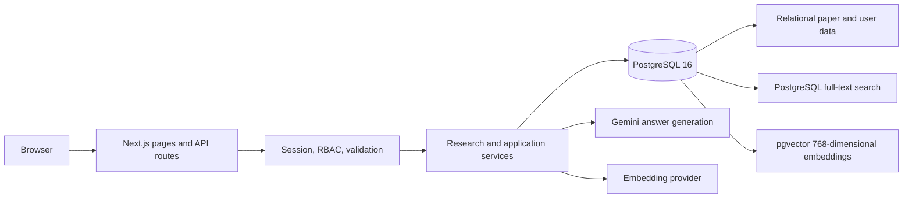
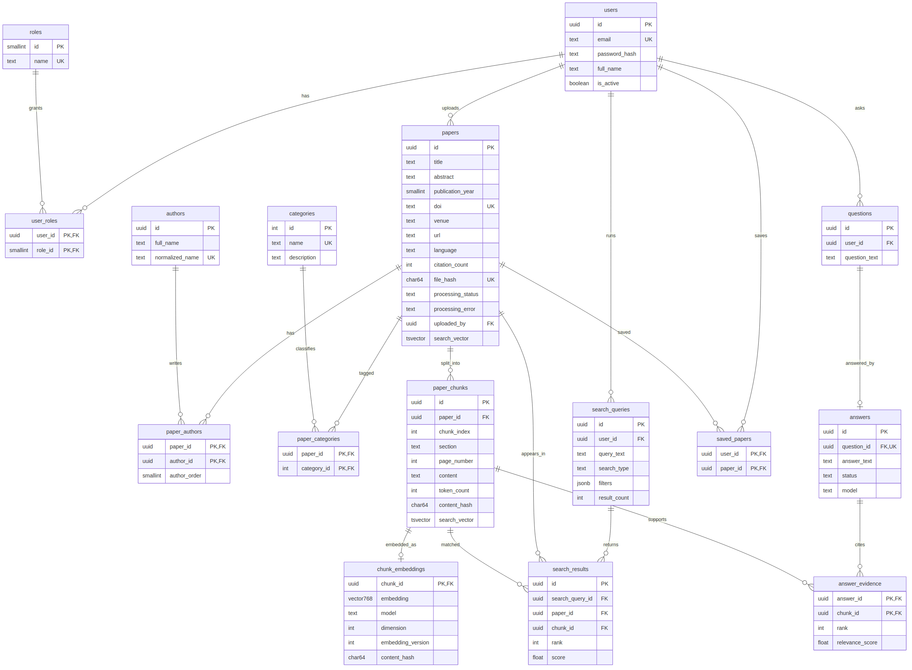

# ResearchIQ

**ResearchIQ** is an AI-assisted research paper intelligence system. It combines a PostgreSQL paper library, keyword and semantic retrieval, and answers grounded in retrieved paper passages.

> This repository is an academic project implementation. Provider-backed answers and database-backed workflows require local configuration; see the known limitations below.

## Problem and objectives

Keyword-only search can miss relevant papers when authors use different terminology. Generic generated answers can be difficult to verify. ResearchIQ aims to help a researcher:

- organize paper metadata, authors, categories, extracted passages, and embeddings;
- discover work through PostgreSQL full-text and vector similarity search;
- ask questions against retrieved evidence and follow citations back to source chunks;
- support researcher and administrator workflows with server-side role checks;
- demonstrate relational design, constraints, indexes, transactions, triggers, functions, and application integration.

## Features

- Registration, login, signed `HttpOnly` sessions, and `ADMIN` / `RESEARCHER` roles.
- Paper library, detail pages, categories, saved papers, keyword search, semantic search, history, and Ask ResearchIQ.
- PDF validation, extraction, cleaning, chunking, metadata detection, duplicate checks, and embedding persistence.
- Evidence-grounded answers whose citations are checked against retrieved chunk IDs.
- Admin paper upload, processing status, categories, user listing, analytics, and GitHub Release PDF import.
- API input validation, parameterized SQL, same-origin checks, rate limits, and safe error responses.

## Technology and architecture

- **Application:** Next.js App Router, React, TypeScript.
- **Database:** PostgreSQL 16 with the `pgvector` extension.
- **AI:** Gemini `generateContent` for answer generation when `AI_BASE_URL` uses Google's Generative Language host; embeddings use an OpenAI-compatible embeddings endpoint.
- **Validation and runtime:** Zod, `pg`, Node.js 20 or newer.



### Database architecture

PostgreSQL is the only database. It stores normalized relational entities and pgvector embeddings in the same database. The schema has 16 core tables in migration 001; migration 005 adds GitHub release asset tracking. `paper_chunks` stores passages and `chunk_embeddings` stores one `vector(768)` per chunk. PostgreSQL `tsvector` columns and GIN indexes support full-text search; an HNSW cosine-distance index supports approximate vector retrieval.

The migrations are the schema source of truth. The schema overview, ER diagram, and SQL examples are in [`database/`](database/) and [`docs/`](docs/).



Editable diagram source: [`docs/er-diagram.mmd`](docs/er-diagram.mmd).

## Repository map

```text
app/                         Next.js pages and API route handlers
components/                  Shared UI, auth, paper, search, and admin components
database/migrations/         Ordered up/down PostgreSQL migrations
database/schema.sql          Consolidated schema reference
database/seed.sql            Optional sample metadata/content for development
docs/                        Architecture, security, API, DBMS, and operations docs
lib/auth/                    Password hashing, sessions, and role policy
lib/db/                      PostgreSQL client, queries, and transactions
lib/research/                PDF extraction, cleaning, chunking, and ingestion
lib/search/                  Keyword search, semantic search, and history
lib/vector/                  Embedding clients, vector storage, filters, and lifecycle
scripts/                     Migration, admin bootstrap, ingestion, and embedding scripts
tests/                       Unit and optional disposable-database integration tests
```

## Requirements

- Node.js 20 or newer and npm.
- PostgreSQL 16 with pgvector installed and enabled for the target database.
- A PostgreSQL login with the permissions needed by the application migrations and app role.
- Gemini/embedding API credentials for semantic search, ingestion, and answer generation. Keyword search and basic pages do not call AI providers.

Docker is optional. A local PostgreSQL installation, including PostgreSQL running in WSL and forwarded to Windows localhost, can be used.

## Windows setup

From PowerShell in the repository root:

```powershell
npm.cmd ci
if (Test-Path .env.local) { throw '.env.local already exists; preserve it and edit only missing settings.' }
Copy-Item .env.example .env.local
$sessionSecret = node -e "process.stdout.write(require('node:crypto').randomBytes(48).toString('base64'))"
(Get-Content .env.local -Raw) -replace '(?m)^SESSION_SECRET=$', "SESSION_SECRET=$sessionSecret" | Set-Content .env.local
Remove-Variable sessionSecret
```

Edit `.env.local` and set `DATABASE_URL`, `EMBEDDING_API_KEY`, `AI_API_KEY`, and provider model settings as needed. `AI_API_KEY` and `EMBEDDING_API_KEY` are server-only; do not use `NEXT_PUBLIC_` names. Keep `.env.local` private and never commit it.

For PostgreSQL running in WSL, start the existing service and confirm it is ready before running the app:

```powershell
wsl.exe -e bash -lc "sudo service postgresql start && pg_isready -h 127.0.0.1 -p 5433"
```

For initial setup, set `DATABASE_URL` to the verified development database and a database-owner/migration login that can create the schema and extensions. Example shape only (replace placeholders locally):

```text
postgresql://researchiq_migrator:<password>@localhost:5433/researchiq_dev
```

Create/provision a separate empty development database and database role through your PostgreSQL administrator. Do not point the app or test commands at production or another unrelated database. Migration 001 enables pgvector; the database must have permission to create/use the extension.

## Migrations and administrator bootstrap

With `.env.local` configured, apply only pending migrations:

```powershell
node --env-file=.env.local --import tsx scripts/migrate.ts
```

The migration runner records applied migrations and does not reset existing tables. Migration 004 creates/grants the least-privileged `researchiq_app` role as `NOLOGIN`; have the PostgreSQL administrator enable that role's login and set its password out of band. After migrations, change `.env.local` `DATABASE_URL` to the `researchiq_app` login for runtime. Keep owner credentials out of the running app configuration; temporarily use them only when applying a future migration. Do not use `npm run migrate:down` as setup; it reverts the most recent applied migration.

To create the first administrator, set `ADMIN_EMAIL`, `ADMIN_NAME`, and `ADMIN_PASSWORD` in the ignored `.env.local`, then run:

```powershell
node --env-file=.env.local --import tsx scripts/create-admin.ts
```

The script creates a new account and assigns `ADMIN` in a transaction; it will not promote a public registration. Do not put the password in a command argument or share terminal output containing secrets.

## Run the application

```powershell
npm.cmd run dev
```

Open [http://localhost:3000](http://localhost:3000). The development server binds to loopback (`127.0.0.1`). For a production build:

```powershell
npm.cmd run build
npm.cmd start
```

## GitHub Release assets

The public repository can also provide PDF inputs through GitHub Releases. ResearchIQ stores release metadata in `github_release_assets`; it does not commit the PDFs or use the metadata snapshot as an import source. An administrator explicitly synchronizes releases and imports an eligible PDF from `/admin/github`. See [`docs/github-releases.md`](docs/github-releases.md). Large downloadable files remain attached to GitHub Releases rather than tracked in Git.

## Sample workflow

1. Sign in as a researcher or register a researcher account.
2. Browse the paper library or run keyword search.
3. Use semantic search when embeddings are available.
4. Ask a question and inspect the evidence citations and history.
5. An administrator can upload a PDF at `/admin/papers` or synchronize and import an eligible GitHub Release PDF at `/admin/github`.
6. Confirm imported papers reach `COMPLETED` before using semantic search or Ask.

The optional `database/seed.sql` contains sample metadata, short project-written text, and demo users with non-functional placeholder password hashes. `npm run seed` also attempts to generate embeddings, which calls the configured provider and changes the target database. Use it only on an intentional development database; do not use the demo accounts in production.

## API overview

API endpoints are implemented under `app/api/`. Main groups include:

- `/api/auth/*` — register, login, logout, and current session;
- `/api/papers`, `/api/search`, `/api/semantic-search` — library and discovery;
- `/api/questions/*`, `/api/evidence/*`, `/api/history` — question answering and evidence history;
- `/api/saved/*` — per-user saved papers;
- `/api/admin/*` — administrator-only management and GitHub imports.

See [`docs/api.md`](docs/api.md) for methods, permissions, request bodies, and response codes.

## Authentication and authorization

Passwords are stored as scrypt hashes. Sessions are signed, stateless cookies marked `HttpOnly`, `SameSite=Lax`, and `Secure` in production; each authenticated request reloads the active user and roles from PostgreSQL. Public registration always creates a `RESEARCHER`. Admin routes enforce permissions on the server; hiding an admin link in the UI is not the security boundary. See [`docs/authentication.md`](docs/authentication.md) and [`docs/security.md`](docs/security.md).

## Tests and checks

```powershell
npm.cmd test
npm.cmd run typecheck
npm.cmd run lint
npm.cmd run build
git diff --check
```

Unit tests do not need a database. Database integration suites run only when `TEST_DATABASE_URL` is set to a separate, disposable PostgreSQL 16 + pgvector database with migrations applied. Never set it to `researchiq_dev` or production. In PowerShell:

```powershell
$env:DATABASE_URL = '<disposable test database URL>'
node --import tsx scripts/migrate.ts
$env:TEST_DATABASE_URL = '<same disposable test database URL>'
npm.cmd test
Remove-Item Env:DATABASE_URL, Env:TEST_DATABASE_URL
```

Do not execute database integration tests unless you have verified the test database identity. Browser automation is not currently configured, so UI acceptance checks are manual. See [`docs/testing.md`](docs/testing.md).

## DBMS evaluation materials

- **Design and relationships:** [`docs/database-design.md`](docs/database-design.md), [`docs/data-dictionary.md`](docs/data-dictionary.md), [`docs/er-diagram.mmd`](docs/er-diagram.mmd).
- **DDL and constraints:** [`database/schema.sql`](database/schema.sql) and [`database/migrations/`](database/migrations/).
- **SQL examples:** [`database/sample_queries.sql`](database/sample_queries.sql), [`docs/sql-queries.md`](docs/sql-queries.md).
- **Advanced database features:** [`docs/advanced-db-features.md`](docs/advanced-db-features.md) documents implemented triggers, functions, views, indexes, transactions, CTEs, and generated columns. No stored procedures are claimed.
- **Project presentation:** [`DBMS_Presentation_Materials/`](DBMS_Presentation_Materials/) contains presentation text, speaker notes, viva questions, demo steps, SQL examples, database analysis, and a screenshot.

## Known limitations and future work

- PDF metadata extraction is heuristic; manually supplied metadata may be needed for accuracy.
- Embedding and answer generation depend on provider availability, quotas, and configured models. Provider-backed calls are not mocked in production.
- HNSW vector search is approximate; filtered recall depends on index scan settings and corpus size.
- In-process rate limits do not coordinate across multiple app instances; a shared limiter is needed for multi-instance deployment.
- Original uploaded PDF bytes are processed in memory and are not retained by the application. GitHub imports retain asset metadata and the resulting paper relationship, not the PDF bytes.
- Database tests are skipped unless a dedicated disposable test database is configured. No automated browser test runner is configured.
- Performance has not been benchmarked at 1,000 papers; no throughput or retrieval-quality metric is claimed.

Potential next steps include browser end-to-end tests, a shared rate-limit backend, durable background ingestion jobs, improved metadata identifiers such as ORCID, and measured retrieval evaluation.

## Contributors

This project documentation identifies work by team role rather than personal name because verified contributor names were not provided here:

- **Member 1:** relational schema, PostgreSQL/pgvector, ingestion, embedding, search, and evidence services.
- **Member 2:** Next.js application, authentication/RBAC, API integration, admin and researcher interfaces, and application-level tests.

See [`docs/member1-contribution.md`](docs/member1-contribution.md) and [`docs/member2-contribution.md`](docs/member2-contribution.md).
