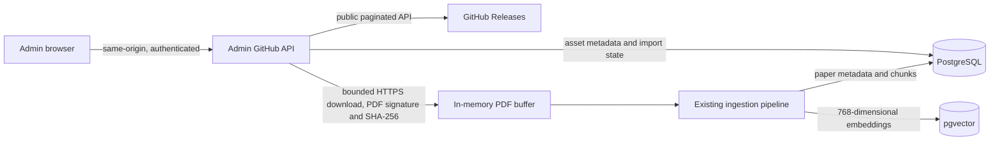

# GitHub release imports

ResearchIQ treats GitHub Releases as an external source of PDF assets. It stores import metadata and processing state in PostgreSQL, then sends each downloaded PDF through the existing in-memory ingestion pipeline. The original PDF is not stored by ResearchIQ.

## Architecture



## Configuration

Add these server-only values to `.env.local`. `GITHUB_TOKEN` is optional for a public repository; never prefix it with `NEXT_PUBLIC_`.

```dotenv
GITHUB_OWNER=mutturaj-angadi
GITHUB_REPO=Research-IQ
GITHUB_TOKEN=
GITHUB_RELEASE_MAX_ASSET_SIZE_MB=50
```

If changing the repository, use a GitHub owner and repository name. The importer accepts only release asset URLs returned by that configured repository and follows HTTPS redirects only to GitHub's release asset hosts. Imports use synchronized PostgreSQL metadata instead of consuming one GitHub API request per asset. The maximum size is fixed by the existing ingestion pipeline at 20 MiB; `GITHUB_RELEASE_MAX_ASSET_SIZE_MB` can lower, but not raise, that limit.

## Database and admin workflow

Apply the additive migration to the intended local development database:

```cmd
node --env-file=.env.local --import tsx scripts/migrate.ts
```

Migration `005_github_release_assets` creates a table for repository/release/asset metadata, import status, safe error text, checksum, attempt timestamps, the initiating admin IDs, and the resulting paper ID. It does not change the existing papers, chunk, or embedding contracts. The table has a unique primary key per GitHub asset ID and a foreign key to papers.

Sign in with an administrator account and open **Admin → GitHub imports**. Refresh discovers and registers published and prerelease release metadata using bounded, idempotent database upserts; drafts are never eligible. PDF assets must have a PDF filename, GitHub's `application/pdf` content type, a positive declared size within the configured limit, and a valid `%PDF-` signature after download. The page supports one asset at a time, retry of failed assets, and sequential import of all currently eligible assets. Repeating synchronization updates release metadata without creating duplicate tracking rows. A repeated completed import returns the linked paper. Duplicate file checksums link to an already completed paper only after checking that it has chunks and a matching embedding for every chunk.

Every import endpoint requires the `papers:upload` permission. Public registration continues to assign only the researcher role. The importer never writes an asset path to disk, and the ingestion pipeline marks papers completed only after embedding persistence. Import tracking marks an item completed only after verifying the paper, chunks, and embeddings in PostgreSQL.

## Run and verify

```cmd
npm.cmd run typecheck
npm.cmd run lint
npm.cmd test
npm.cmd run build
```

Database integration tests require `TEST_DATABASE_URL` to point to a separately provisioned, disposable PostgreSQL 16 database with pgvector and migrations applied. Never point it at `DATABASE_URL` or production data. Verify the database identity before applying migrations or running database-backed tests. If no dedicated test database is available, database persistence and semantic retrieval remain unverified.

## Failures and retry

The admin page shows the last safe processing error and attempt count. Failed items can be retried from the same page. The importer has a 30-minute stale-processing lease so a crashed request can be retried. Common causes include a missing/invalid migration, missing embedding provider configuration, GitHub rate limits, a non-PDF asset, an asset exceeding the configured limit, or a provider failure. GitHub API tokens and database credentials are not returned in API errors. Check server logs for request-level diagnostics, then refresh the page and retry a failed item.

`docs/github-release-manifest.json` records a read-only snapshot of public release and asset metadata observed during this implementation. Runtime discovery uses the GitHub API; the snapshot is not used as an import source.
